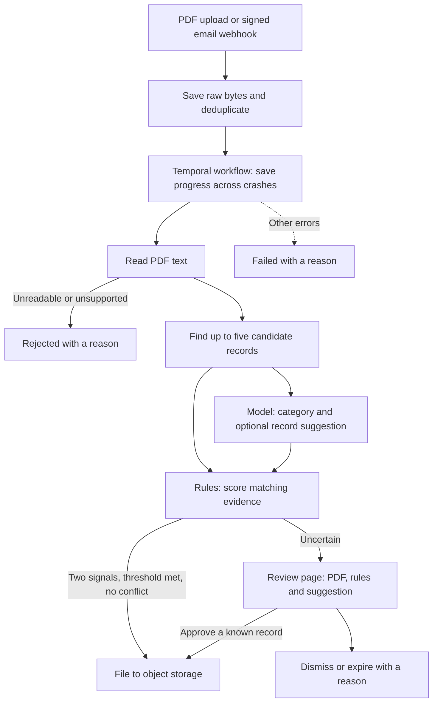

# Docket

Incoming leases, invoices and notices need to reach the right property unit.
Docket reads a PDF, matches it to known units, and files it when the evidence agrees.
Uncertain matches wait for a person. Every step has a trace.
A *record* is one property unit, such as `UNIT-0001`.
The shipped data is synthetic: 200 units and two sets of 180 test documents.

Rules decide automatic filing. A language model can suggest a record to a reviewer.
It never decides which record is filed automatically.
The model is Claude Haiku 5.5 on the Anthropic API, measured live.
In the held-out test, its suggestions were less accurate than the rules.



A *signal* is evidence such as a matching address or tenant name.
Two independent signals must agree before a document can file automatically.
A failed record suggestion does not block the rules.
An unreadable category answer, such as a refusal, sends the document to review.
Temporal runs the steps and saves progress so a worker can resume after a crash.

## Quickstart

Install [uv](https://docs.astral.sh/uv/), then run from this repository:

```sh
uv sync
uv run docket score corpus/seed-7/doc-0001-clean.pdf
```

This prints candidate records, scores and a filing decision.
It needs no model key or running services and writes no filing.

For the service and review page, also install Docker Compose:

```sh
export DOCKET_REVIEW_TOKEN="$(openssl rand -hex 32)"
docker compose up -d --build --wait
uv run docket submit corpus/seed-11/doc-0075-decoy_near_miss_address.pdf
```

Open [the local review page](http://127.0.0.1:8010/reviewer) and enter the token.
The sample waits for review. It uses saved model answers, with no network model call.
The token stays in that browser tab's session storage.
The page shows the PDF, why it needs review, candidate scores, the rules' top pick
and the model's suggestion. Approve either, choose another candidate, or dismiss.
`uv run docket status <document-id>` prints the trace.

The public front page is at [the root address](http://127.0.0.1:8010/) and needs no token.
It plays back recorded seed-11 results for four test documents; nothing is uploaded.
`uv run python -m docket.front_demo` rebuilds its data, and a test fails if it drifts.

Upload with `POST /documents`, or send a signed email payload to `POST /inbound`.
Both have a **10 MB limit (10 MiB, 10 × 1,024 × 1,024 bytes)** on the whole request,
including upload or encoding overhead. Oversize requests return 413.
Locally, every route except the webhook, the health check and the front page with its files needs a reviewer Bearer token.
With `DOCKET_ENV=beta` there is no sign-up: each browser gets a private sandbox that nobody
else can see, and everything in it is deleted within 55 minutes. "Delete now" removes its rows
and stored files before it answers, and the last copies, in the workflow store and on disk,
within a few minutes.
Visitors cannot upload. They send server-made sample documents instead, within per-address
and daily caps and behind a kill switch.
[Run the hosted beta](#run-the-hosted-beta) is the runbook.
The webhook uses a shared-secret signature and a timestamp within five minutes.
See [operations](docs/operations.md) for headers, routes, settings, services and
[beta mode](docs/operations.md#hosted-beta-mode).

## Held-out results

Seed 7 chose the score threshold, 0.5857142. A seed fixes the generated test data.
Seed 11 was *held out*: none of its results selected settings.
The *rules-only baseline* takes the highest-scored candidate without a model.
It uses the same threshold and two-signal rule as Docket.

**These are live answers from claude-haiku-5-5 on the Anthropic API, recorded on 2026-11-13.**
One pass asked each of the 440 requests over seeds 7 and 11 once.
The [report](evals/reports/2026-11-13-seed-11.md) gives every figure below.
[ADR 008](docs/adr/008-real-model.md) has the gates and the predictions made before the pass.
The v0.1 simulated answers are kept as [history](evals/history/simulated/README.md).

**The live pass missed two of its four gates.** The API's safety filter refused both
calls on all 20 `very_long` test documents: 40 of 440 requests (9.1%), against a limit
of 8 (2%). Its category was `bio`. Those documents hold about 8,000 characters of random
synthetic words. A resend was refused again. No injection document was refused.
Docket sends a refused document to review instead of failing it, so nothing is filed
wrongly, but the ten on seed 11 that the rules would file wait for a person.
That misses the recall floor. [Failure 0017](docs/failures/0017-very-long-refusal.md)
explains it.

| Gate | Result |
| --- | --- |
| G1: at most 2% of answers unreadable | **Missed:** 40/440, 9.1% [6.7–12.1], all refusals |
| G2: at most 2% with no answer | Passed: 0/440 |
| G3: seed-11 floors | **Missed on recall:** 28/39 against the baseline's 38/39. No wrong filings, all 10 clean documents filed, no filing to an injected id |
| G4: spend under $5 | Passed: $0.0293 for the pass |

A *gold label* is the expected answer supplied with a test document.
Precision is correct filings divided by all automatic filings.
Recall is correct filings divided by the 39 documents labelled for filing.

| Measure | Docket | Rules only |
| --- | --- | --- |
| Filing precision | 28/28, 100% [87.9–100] | 38/38, 100% [90.8–100] |
| Filing recall | 28/39, 71.8% [56.2–83.5] | 38/39, 97.4% [86.8–99.5] |
| Share filed automatically | 28/180, 15.6% [11.0–21.6] | 38/180, 21.1% [15.8–27.6] |
| Share sent to review | 112/180, 62.2% [55.0–69.0] | 102/180, 56.7% [49.4–63.7] |
| Pipeline category accuracy, among 140 not rejected | 116/140, 82.9% [75.8–88.2] | 132/140, 94.3% [89.1–97.1] |
| Correct record on review items | 43/102, 42.2% [33.0–51.9] | 62/102, 60.8% [51.1–69.7] |

Brackets give 95% Wilson intervals: uncertainty ranges for the measured proportions.
They do not establish accuracy on real incoming documents.
The 10 filings Docket gives up are the refused `very_long` documents; it files nothing
the rules would not. The other 40 documents were rejected.
Of the 120 documents that reached the model, the category was right on 112.
Every readable category answer was right (110 of 110); the ten refused fell back to misc,
which matched gold on two. The other 16 category misses came from empty shortlists,
assigned misc without a model call.
The suggestion comparison leaves out the 10 review documents whose suggestion was refused.
Suggesting none is correct when gold names no record.

| Cost and speed | Seed 11 | Whole pass |
| --- | --- | --- |
| Model spend | $0.0147 | $0.0293 (440 calls) |
| Per document that reached the model | $0.000122 | $0.000122 |
| Per document not rejected | $0.000105 | $0.000105 |
| Per document overall | $0.000081 | $0.000081 |
| Latency per call, median / 95th percentile | 1.29 s / 2.69 s | 1.33 s / 2.56 s |

Cost is tokens times the [price snapshot](config/model_prices.yaml) of 2026-11-12.
The [cost summary](evals/cost/2026-11-13-claude-haiku-5-5.json) rebuilds it from the recordings.
Every answer used structured output; the schema fallback was never needed.

The threshold curve below comes directly from the committed report.
Each cell gives a percentage and its 95% Wilson interval.
The auto-file rate is the share of all 180 documents selected for filing.

| Threshold | Docket precision | Rules precision | Docket auto-file rate | Rules auto-file rate |
| --- | --- | --- | --- | --- |
| 0.5500000 | 100.0% [88.3–100.0] | 100.0% [91.0–100.0] | 16.1% [11.5–22.2] | 21.7% [16.3–28.2] |
| 0.6142857 | 100.0% [87.9–100.0] | 100.0% [90.8–100.0] | 15.6% [11.0–21.6] | 21.1% [15.8–27.6] |
| 0.6785714 | 100.0% [86.7–100.0] | 100.0% [90.1–100.0] | 13.9% [9.6–19.7] | 19.4% [14.3–25.8] |
| 0.7428571 | 100.0% [86.7–100.0] | 100.0% [90.1–100.0] | 13.9% [9.6–19.7] | 19.4% [14.3–25.8] |
| 0.8071429 | 100.0% [86.7–100.0] | 100.0% [90.1–100.0] | 13.9% [9.6–19.7] | 19.4% [14.3–25.8] |
| 0.8714286 | 100.0% [85.1–100.0] | 100.0% [89.3–100.0] | 12.2% [8.2–17.8] | 17.8% [12.9–24.0] |
| 0.9357143 | 100.0% [84.5–100.0] | 100.0% [89.0–100.0] | 11.7% [7.8–17.2] | 17.2% [12.4–23.4] |
| 1.0000000 | — | — | 0.0% [0.0–2.1] | 0.0% [0.0–2.1] |

At threshold 1.0 there are no filings, so precision is undefined.
The eight thresholds produce six distinct precision/rate pairs for each system.
At every threshold Docket's rate is lower by the refused `very_long` documents.
The [JSON report](evals/reports/2026-11-13-seed-11.json) contains unrounded values,
per-case results and each review suggestion.
[Failure notes](docs/failures/README.md) show missed filings and wrong suggestions.

## Crash and retry checks

Five fault tests stop real Compose processes and check recovery.
A failpoint is a named place where a test deliberately exits a process.
Each process-crash test checks exit code 137 and the fired-point log.

| Fault | Checked outcome |
| --- | --- |
| Worker exits after storage, before the database write | One filing object, one filing row and one filed event after restart |
| Worker exits in choose | Same single-filing checks after restart |
| API exits after the raw upload | Resubmission recovers one document and one filing |
| API exits after the document row, before workflow start | Reconciliation starts the missing workflow; one filing |
| Storage goes offline during worker recovery | A real connection error, then one filing after storage returns |

The worker-crash cases also submit three requests concurrently and resubmit after filing
under a different message id. They still produce one document and one filing.
Steps may run again. Database uniqueness and repeat-safe storage writes prevent duplicate effects.
The suite does not measure outages longer than the retry window or production failover.
See [ADR 007](docs/adr/007-temporal-recovery.md) for the measured scope.

## Limits

- Deduplication uses exact bytes. Near-duplicates with different bytes remain separate documents.
- There is no optical character recognition (OCR), which reads text from page images.
  Scans without a text layer go to review.
- Documents are synthetic. The live figures measure Haiku 5.5 on this test set, not on real mail.
- Haiku's safety filter refuses the synthetic `very_long` documents (category `bio`), so the
  live pass missed its unreadable-answer and recall gates. Those documents go to review.
- Conflicting evidence and single-signal matches go to review. This protects filing precision
  at the cost of more human work.
- An unreadable category answer sends the document to review. A category call with no
  answer at all still fails the document.
- Matching has field-size budgets. Over-budget input goes to review rather than losing evidence
  through silent truncation. [Operations](docs/operations.md#how-a-document-is-matched) gives the limits.
- Local Compose uses a Temporal development server, one API process and one shared reviewer token.
  This is not a measured production deployment or an individual-user permissions system.

## Run the hosted beta

The hosted beta, <https://docket.cristianortega.dev>, runs `compose.prod.yaml` on one
host behind [Caddy](https://caddyserver.com), which handles HTTPS. Its six services each
have a memory and CPU limit, restart unless stopped, and rotate their logs:

| Service | Memory limit | Peak in the load run |
| --- | --- | --- |
| `temporal`: the Temporal dev server, on a SQLite file ([ADR 009](docs/adr/009-hosting.md)) | 768 MB | 310 MB |
| `postgres` | 512 MB | 73 MB |
| `seaweedfs`: the S3 store | 512 MB | 129 MB |
| `api`, the only service with a published port, on `127.0.0.1` | 512 MB | 260 MB |
| `worker`, the only service with the model key | 768 MB | 276 MB |
| `sweep`: deletes what expired and deleted sandboxes held, every 2 minutes | 256 MB | Not measured |
| **Total** | **3.3 GB** | **1.4 GB**, from a run made before the sweep, with a nightly reset in its place |

`migrate` and `temporal-data-init` run once at start and exit. The load run
(`scripts/load/beta_load.py`) sent 60 samples in 10 minutes from four addresses, with
review actions and one sweep by hand, against a local stand-in for the model API. It runs as
its own Compose project, `docket-load`, on fresh volumes, and sends nothing until it has
checked that the worker's model address is the stand-in and the key is not a real one. [ADR 009](docs/adr/009-hosting.md) has the details.

Every command below runs in the release folder on the host. Compose reads the settings
from `.env.beta` only through `--env-file .env.beta`. Without it, compose stops and names
the first missing setting.

1. **Settings.** `cp .env.beta.example .env.beta && chmod 600 .env.beta`, then fill in
   every blank. `openssl rand -hex 32` makes each random value, `DOCKET_ADDRESS_KEY`
   included. The API key is the beta's own, with a monthly spend limit set at the provider.
2. **Check the settings.** `python3 scripts/check_prod_compose.py .env.beta` prints
   `OK: 8 services.` and what it checked: only the API is published, on 127.0.0.1;
   every service has limits and log rotation; only the worker gets the model key; no
   secret is on a command line. It never prints a value. It stops if one of the settings
   is also set in the shell, because compose would use the shell's value.
3. **Start.** `docker compose -f compose.prod.yaml --env-file .env.beta up -d --build --wait --remove-orphans`
   builds the image, runs the migrations and returns once every service is healthy.
   `--remove-orphans` removes any container of a service this file no longer names.
   `sweep` runs its first pass at once. Until one completes, samples get 503 "Docket is
   catching up".
4. **Check it.** `curl -s http://127.0.0.1:8001/healthz` prints `{"status":"ok"}`, and
   `curl -s http://127.0.0.1:8001/review` prints `{"items":[]}`: with no sandbox cookie
   there is nothing to see. `docker compose -f compose.prod.yaml --env-file .env.beta ps`
   lists the six services as `healthy`.
5. **Caddy.** Back up the Caddyfile, add this block beside the others, validate, then
   reload:

   ```
   docket.cristianortega.dev {
       request_body {
           max_size 32KB
       }
       reverse_proxy 127.0.0.1:8001
   }
   ```

   `max_size` stops a large body at Caddy. It sits above Docket's own 16 KB limit, so
   Docket's refusal is the one visitors see. Caddy appends the client address to
   `X-Forwarded-For`, which `DOCKET_TRUST_PROXY=1` reads.

   ```sh
   sudo cp /etc/caddy/Caddyfile /etc/caddy/Caddyfile.bak-$(date +%Y%m%d-%H%M%S)
   sudo caddy validate --config /etc/caddy/Caddyfile   # must end "Valid configuration"
   sudo systemctl reload caddy
   ```

   Never reload a file that did not validate. To roll back, copy the backup over
   `/etc/caddy/Caddyfile`, validate it, and reload.

Below, define `compose() { docker compose -f compose.prod.yaml --env-file .env.beta "$@"; }`
in the shell first.

**Upgrade from the invite-code release.** That release runs a nightly `reset` service, which
this compose file does not name, and its shared queue belongs to no sandbox. Nothing writes
from step 1 until step 5 starts the API, so the cleanup in step 4 cannot delete a new sandbox:

1. With the old release still checked out: `cp .env.beta .env.beta.bak-$(date +%Y%m%d)`,
   then `compose stop api worker` and `compose rm -sf reset`.
2. Check out the new release. In `.env.beta`, delete `DOCKET_INVITE_CODES` and
   `DOCKET_SESSION_KEY`, add `DOCKET_ADDRESS_KEY`, and set
   `DOCKET_REVIEW_TIMEOUT_SECONDS=3000`; `python3 scripts/check_prod_compose.py .env.beta`
   must print `OK`.
3. `compose build`, then `compose up -d --wait --remove-orphans temporal seaweedfs postgres`,
   which restarts Temporal with `secure_delete` on, then `compose run --rm migrate`.
4. `compose run --rm --no-deps sweep docket beta-sweep --all` deletes the old queue, its
   files and its histories. It must end with `'complete': True`; if Temporal was still
   starting, run it again.
5. `compose up -d --wait --remove-orphans` starts the API, the worker and the sweep, and
   `compose ps` lists no `reset`.

Day to day:

- **Live answers off and on.** `compose exec -T api docket beta-switch off` prints
  `Live answers are off.`, and `... beta-switch on` prints `Live answers are on.` Samples
  get 503 while it is off. No restart is needed.
- **Status.** `compose exec -T api docket beta-status` prints how long ago the last
  complete sweep ran, the sandboxes live and waiting for the sweep, the last hour's new
  sandboxes and samples with how many addresses are at each limit, and the day's spend.
- **Sweep by hand.** `compose run --rm --no-deps sweep docket beta-sweep` runs the three
  passes once, prints `Sweep: {...}`, and exits 1 unless all three finished.
- **Delete everything.** Maintenance only, never day to day: `beta-sweep --all` deletes every
  sandbox, live ones too, every document outside a sandbox, and every object in the bucket.
  A sample accepted while it runs could keep its rows and lose its file, so stop writes
  first: `compose stop api worker sweep`, then
  `compose run --rm --no-deps sweep docket beta-sweep --all`, then
  `compose up -d --wait`.
- **Logs.** `compose logs --tail 50 sweep` shows the result line of each run.
- **Back up.** Never: no copy of Docket's volumes is made, because a copy would keep what
  a sandbox held past its hour.
- **Stop.** `compose down` stops and removes the containers. The volumes stay.

## Check and explore

Checks also need Node.js 22.12+. Start Compose first:

```sh
./verify.sh
./verify.sh --fault
```

Both enforce zero skipped tests, coverage floors, formatting, type checks, browser checks,
Docker builds, the saved-answer archive and secret scanning.
They also replay seed 11 and compare it with the saved results, without a model call.

`./verify.sh --step lint|web|eval|secrets` runs one part of these checks. GitHub Actions runs the
parts and the test suite as parallel jobs, as [verify.yml](.github/workflows/verify.yml) shows.
Pull requests skip the fault suite; pushes to main, the nightly run and manual runs include it.
The two commands above run everything on one machine.

- [Product brief](docs/product-brief.md): users, scope and measures.
- [Decision records](docs/adr/README.md): choices and measured limits.
- [Build log](docs/build-log.md): dated decisions and what review caught.
- [Operations](docs/operations.md): matching, API, storage, model budgets and local services.
- [Replay instructions](docs/rerecord.md): reproduce the reports or record real-provider answers.
- [Evidence archive](evals/recordings/README.md): live requests, answers, tokens and provenance.
- [Build plan](builds/v01/plan.md): acceptance criteria and approved changes.

Apache-2.0. See [LICENSE](LICENSE).
